---
I am a researcher at Token Foundary, Alibaba Token Hub. I am also a postdoctoral researcher in the joint program between Alibaba Group and Shanghai Jiao Tong University, advised by Prof. Jieping Ye and Prof. Lizhuang Ma. I received my Ph.D. from Shanghai Jiao Tong University, supervised by Prof. Lizhuang Ma and Prof. Cewu Lu.

My research focuses on **Multimodal Large Language Models**, **Spatial Intelligence**, and **Physical AI**. I am particularly interested in how multimodal models can develop spatial understanding and use it to reason about and interact with the physical world.

## Projects
<table class="projects" style="width:100%;border:0px;border-spacing:0px;border-collapse:separate;margin-right:auto;margin-left:auto;">
  <tbody>
    <tr>
      <td>
        

          
        

      </td>
      <td>
        <strong>SpatialAxiom</strong>
         
          An Open Spatial Intelligence Model for General Spatial Reasoning
         
          [<a href="https://d2i-ai.github.io/SpatialAxiom/">project</a>]
      </td>
    </tr>
  </tbody>
</table>

## Publications 
<table class="publications" style="width:100%;border:0px;border-spacing:0px;border-collapse:separate;margin-right:auto;margin-left:auto;">
  <tbody>
    <tr>
      <td>
        

          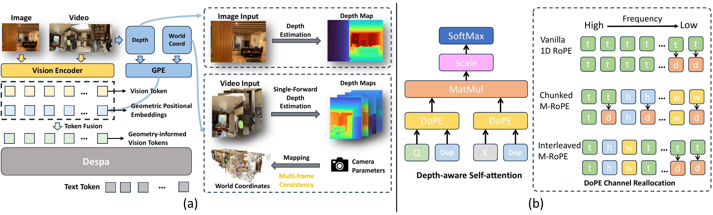
        

      </td>
      <td>
        <papertitle>
          <strong>Despa: Resolving Spatial Collapse in VLMs via Depth-Grounded Geometry</strong>
        </papertitle>
         
          <strong>Yujing Lou</strong>, Pingyi Chen, Shen Cao, Lubin Fan, Yue Wu, Lizhuang Ma, Jieping Ye
         
          <strong>Fortieth Annual Conference on Neural Information Processing Systems (NeurIPS), 2026</strong>
         
          [arXiv]
          [paper]
          [<a href="/despa/">project</a>]
      </td>
    </tr>
    <tr>
      <td>
        

          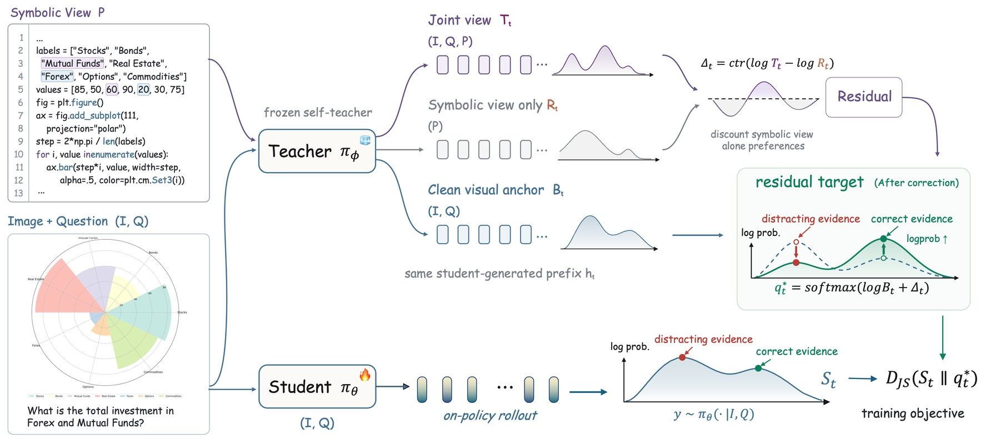
        

      </td>
      <td>
        <papertitle>
          <strong>MM-OPD: Towards One More Bottleneck Between Perception and Reasoning</strong>
        </papertitle>
         
          Jintao Tong, <strong>Yujing Lou</strong>, Zhanming Shen, Jiaqi Gu, Lubin Fan, Ruixuan Li, Yue Wu, Jieping Ye, Yixiong Zou
         
          <strong>arXiv, 2026</strong>
         
          [<a href="https://arxiv.org/abs/2609.32690">arXiv</a>]
      </td>
    </tr>
    <tr>
      <td>
        

          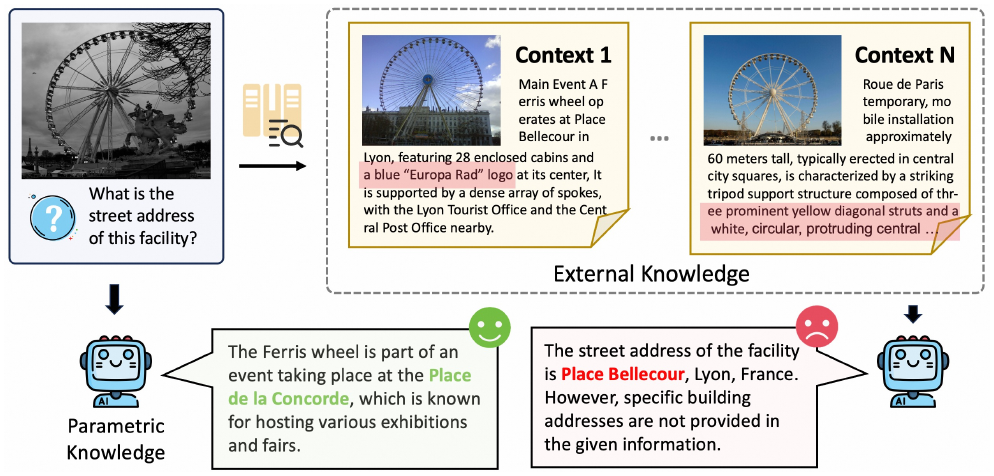
        

      </td>
      <td>
        <papertitle>
          <strong>CC-VQA: Conflict- and Correlation-Aware Method for Mitigating Knowledge Conflict in Knowledge-Based Visual Question Answering</strong>
        </papertitle>
         
          Yuyang Hong, Jiaqi Gu, <strong>Yujing Lou</strong>, Lubin Fan, Qi Yang, Ying Wang, Kun Ding, Yue Wu, Shiming Xiang, Jieping Ye
         
          <strong>IEEE/CVF Conference on Computer Vision and Pattern Recognition (CVPR), 2026</strong>
         
          [<a href="https://arxiv.org/abs/2602.23952">arXiv</a>]
          [<a href="https://openaccess.thecvf.com/content/CVPR2026/html/Hong_CC-VQA_Conflict-_and_Correlation-Aware_Method_for_Mitigating_Knowledge_Conflict_in_CVPR_2026_paper.html">paper</a>]
      </td>
    </tr>
    <tr>
      <td>
        

          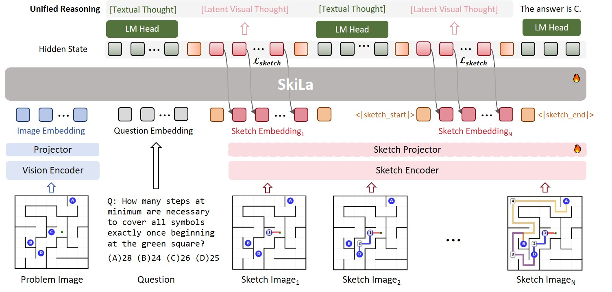
        

      </td>
      <td>
        <papertitle>
          <strong>Sketch-in-Latents: Eliciting Unified Reasoning in MLLMs</strong>
        </papertitle>
         
          Jintao Tong, Jiaqi Gu, <strong>Yujing Lou</strong>, Lubin Fan, Yixiong Zou, Yue Wu, Jieping Ye, Ruixuan Li
         
          <strong>arXiv, 2025</strong>
         
          [<a href="https://arxiv.org/abs/2512.16584">arXiv</a>]
      </td>
    </tr>
    <tr>
      <td>
        

          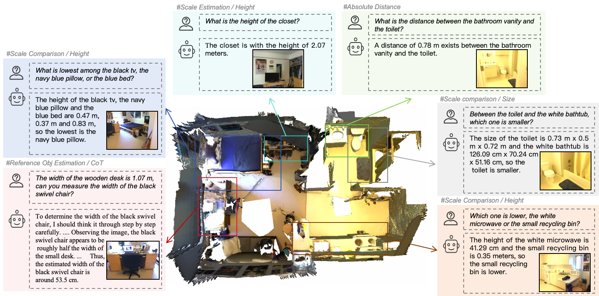
        

      </td>
      <td>
        <papertitle>
          <strong>SD-VLM: Spatial Measuring and Understanding with Depth-Encoded Vision-Language Models</strong>
        </papertitle>
         
          Pingyi Chen*, <strong>Yujing Lou*</strong>, Shen Cao, Jinhui Guo, Lubin Fan, Yue Wu, Lin F. Yang, Lizhuang Ma, Jieping Ye (* equal contribution)
         
          <strong>Thirty-Ninth Annual Conference on Neural Information Processing Systems (NeurIPS), 2025</strong>
         
          [<a href="https://arxiv.org/abs/2509.17664">arXiv</a>]
          [<a href="https://papers.neurips.cc/paper_files/paper/2025/hash/30bc3a3a44c9d2e3f32e6dd1cd18f552-Abstract-Conference.html">paper</a>]
          [<a href="https://cpystan.github.io/SD_VLM_pages/">project</a>]
      </td>
    </tr>
    <tr>
      <td>
        

          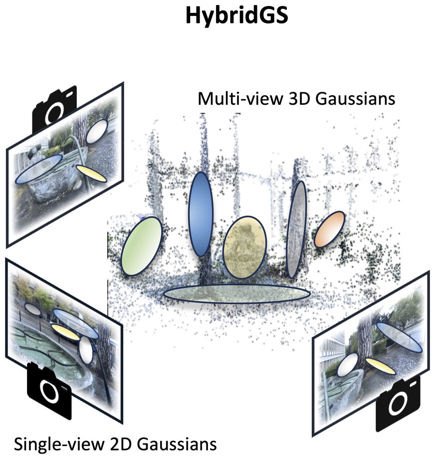
        

      </td>
      <td>
        <papertitle>
          <strong>HybridGS: Decoupling Transients and Statics with 2D and 3D Gaussian Splatting</strong>
        </papertitle>
         
          Jingyu Lin, Jiaqi Gu, Lubin Fan, Bojian Wu, <strong>Yujing Lou</strong>, Renjie Chen, Ligang Liu, Jieping Ye
         
          <strong>IEEE/CVF Conference on Computer Vision and Pattern Recognition (CVPR), 2025</strong>
         
          [<a href="https://arxiv.org/abs/2412.03844">arXiv</a>]
          [<a href="https://openaccess.thecvf.com/content/CVPR2025/html/Lin_HybridGS_Decoupling_Transients_and_Statics_with_2D_and_3D_Gaussian_CVPR_2025_paper.html">paper</a>]
          [<a href="https://gujiaqivadin.github.io/hybridgs/">project</a>]
      </td>
    </tr>
    <tr onmouseout="nightsight_stop()" onmouseover="nightsight_start()">
      <td>
        

          
        

      </td>
      <td>
        <papertitle> 
          <strong>CRIN: Rotation-Invariant Point Cloud Analysis and Rotation Estimation via Centrifugal Reference Frame</strong>
        </papertitle>
         
          <strong>Yujing Lou</strong>, Zelin Ye, Yang You, Nianjuan Jiang, Jiangbo Lu, Weiming Wang, Lizhuang Ma, Cewu Lu
         
          <strong>AAAI Conference on Artificial Intelligence (AAAI), 2023 (Oral)</strong>
         
        [<a href="https://arxiv.org/abs/2303.03101">arXiv</a>] 
        [<a href="https://ojs.aaai.org/index.php/AAAI/article/view/25271">paper</a>]
      </td>
    </tr>
    <tr onmouseout="nightsight_stop()" onmouseover="nightsight_start()">
      <td>
        

          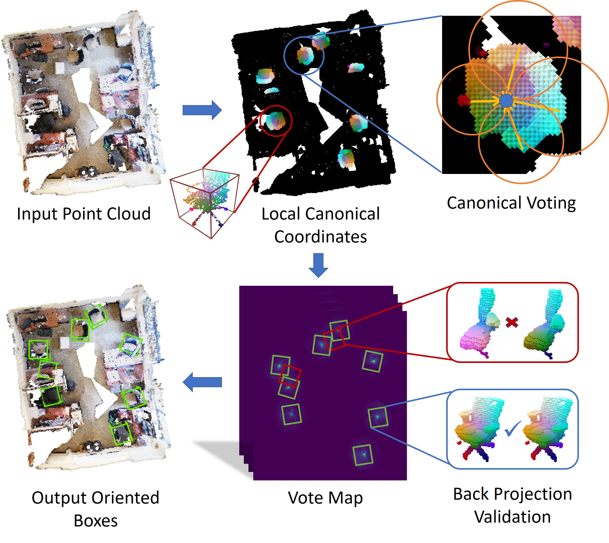
        

      </td>
      <td>
        <papertitle> 
          <strong> Canonical Voting: Towards Robust Oriented Bounding Box Detection in 3D Scenes </strong> 
        </papertitle>
         
          Yang You, Zelin Ye, <strong>Yujing Lou</strong>, Chengkun Li, Yong-Lu Li, Lizhuang Ma, Weiming Wang, Cewu Lu
         
          <strong>IEEE Conference on Computer Vision and Pattern Recognition (CVPR), 2022</strong>
         
          [<a href="https://arxiv.org/abs/2011.12001">arXiv</a>] 
          [<a href="https://openaccess.thecvf.com/content/CVPR2022/papers/You_Canonical_Voting_Towards_Robust_Oriented_Bounding_Box_Detection_in_3D_CVPR_2022_paper.pdf">paper</a>] 
      </td>
    </tr>
    <tr onmouseout="nightsight_stop()" onmouseover="nightsight_start()">
      <td>
        

          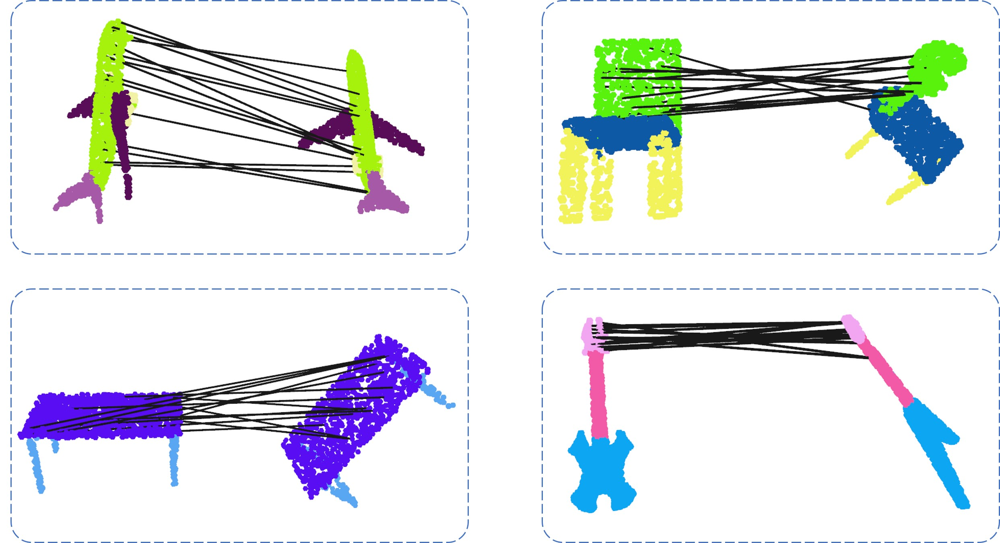
        

      </td>
      <td>
        <papertitle> 
          <strong> PRIN/SPRIN: On Extracting Point-wise Rotation Invariant Features </strong>
        </papertitle>
         
          Yang You, <strong>Yujing Lou</strong>, Ruoxi Shi, Qi Liu, Yu-Wing Tai, Lizhuang Ma, Weiming Wang, Cewu Lu
         
          <strong>IEEE Transactions on Pattern Analysis and Machine Intelligence (TPAMI), 2021</strong>
         
          [<a href="https://arxiv.org/abs/2102.12093">arXiv</a>]
          [<a href="https://ieeexplore.ieee.org/document/9627565">paper</a>]
      </td>
    </tr>
    <tr onmouseout="nightsight_stop()" onmouseover="nightsight_start()">
      <td>
        

          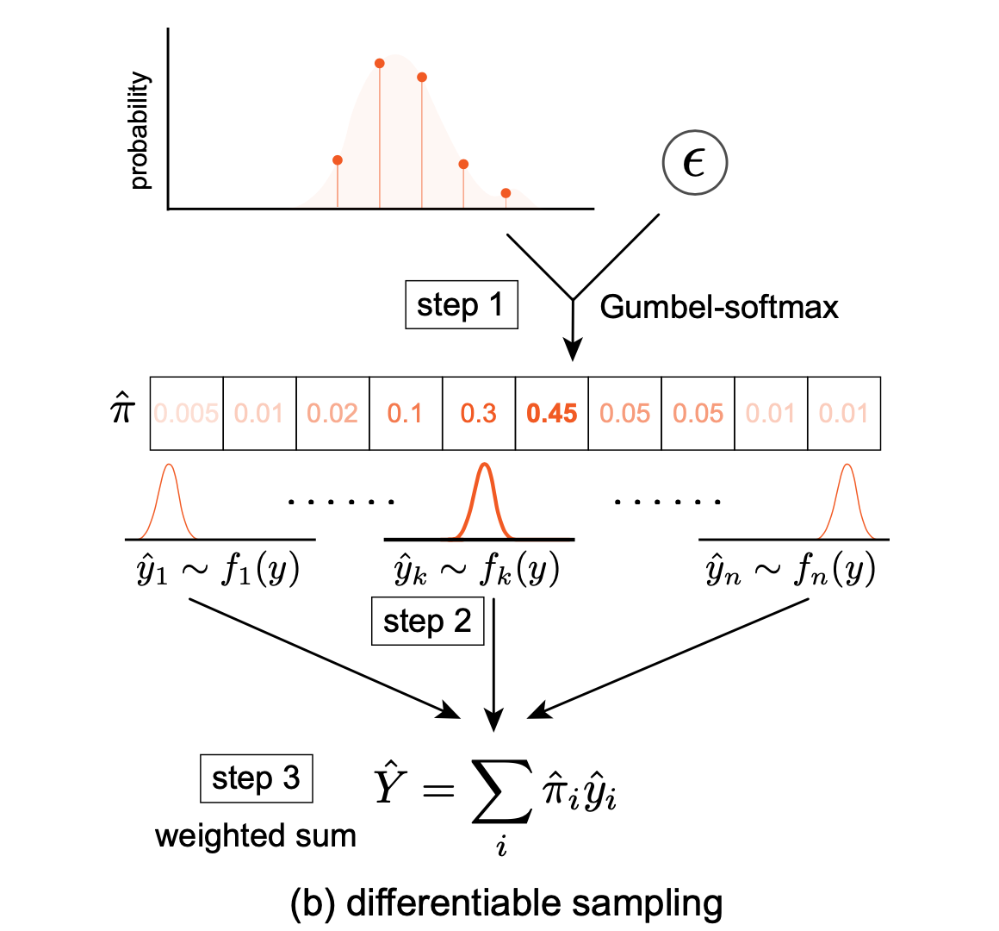
        

      </td>
      <td>
        <papertitle>
          <strong> Localization with Sampling-Argmax </strong>
        </papertitle>
         
          Jiefeng Li, Tong Chen, Ruiqi Shi, <strong>Yujing Lou</strong>, Yong-Lu Li and Cewu Lu
         
          <strong>Thirty-Fifth Annual Conference on Neural Information Processing Systems (NeurIPS), 2021</strong>
         
          [<a href="https://arxiv.org/abs/2110.08825">arXiv</a>] 
          [<a href="https://proceedings.neurips.cc/paper/2021/file/e4a6222cdb5b34375400904f03d8e6a5-Paper.pdf">paper</a>] 
      </td>
    </tr>
    <tr onmouseout="nightsight_stop()" onmouseover="nightsight_start()">
      <td>
        

          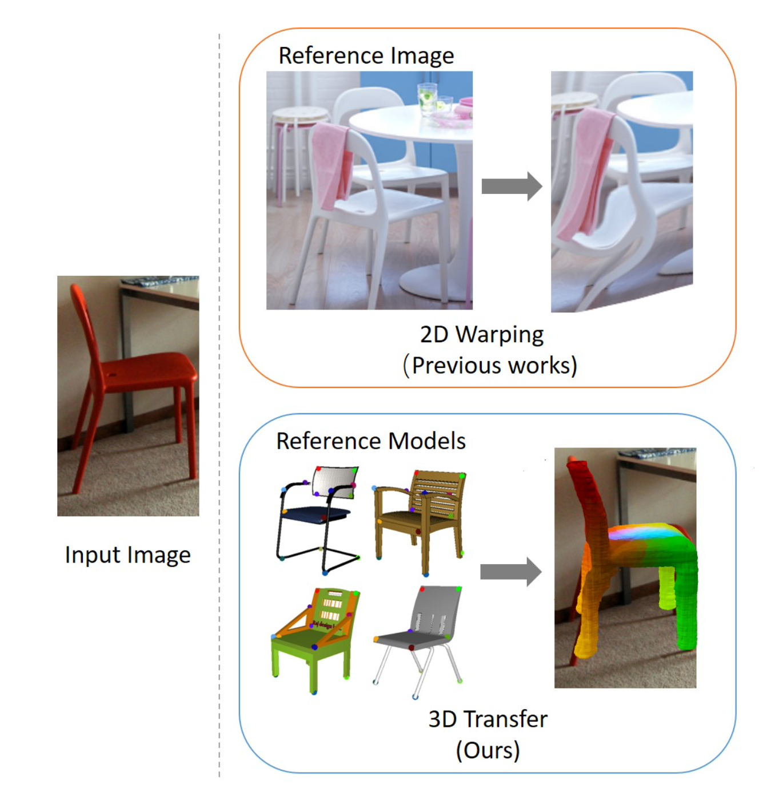
        

      </td>
      <td>
        <papertitle>
          <strong> Understanding Pixel-level 2D Image Semantics with 3D Keypoint Knowledge Engine </strong>
        </papertitle>
         
          Yang You, Chengkun Li, <strong>Yujing Lou</strong>, Zhoujun Cheng, Liangwei Li, Lizhuang Ma, Weiming Wang, Cewu Lu
         
          <strong>IEEE Transactions on Pattern Analysis and Machine Intelligence (TPAMI), 2021</strong>
         
          [<a href="https://arxiv.org/abs/2111.10817">arXiv</a>]
          [<a href="https://ieeexplore.ieee.org/document/9403947/">paper</a>]
      </td>
    </tr>
    <tr onmouseout="nightsight_stop()" onmouseover="nightsight_start()">
      <td>
        

          
        

      </td>
      <td>
        <papertitle>
          <strong> Human Correspondence Consensus for 3D Object Semantic Understanding </strong>
        </papertitle>
         
          <strong>Yujing Lou*</strong>, Yang You*, Chengkun Li*, Zhoujun Cheng, Liangwei Li, Lizhuang Ma, Weiming Wang, Cewu Lu (* equal contribution)
         
          <strong>European Conference on Computer Vision (ECCV), 2020</strong>
         
          [<a href="https://arxiv.org/abs/1912.12577">arXiv</a>]
          [<a href="https://link.springer.com/chapter/10.1007/978-3-030-58542-6_30">paper</a>]
      </td>
    </tr>
    <tr onmouseout="nightsight_stop()" onmouseover="nightsight_start()">
      <td>
        

          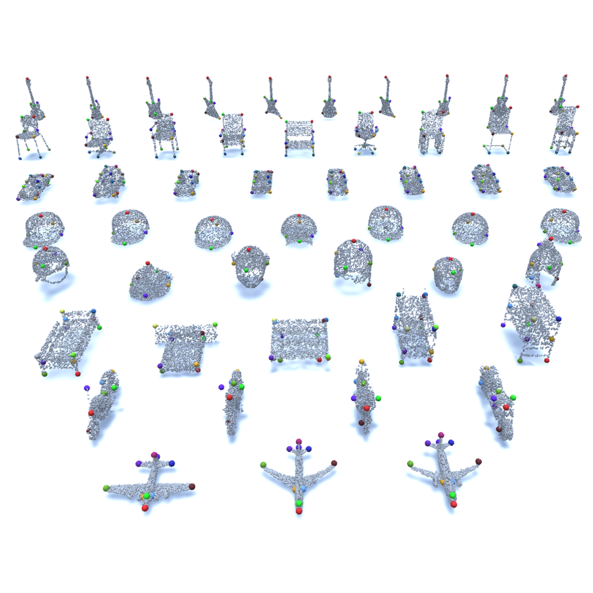
        

      </td>
      <td>
        <papertitle>
          <strong> KeypointNet: A Large-scale 3D Keypoint Dataset Aggregated from Numerous Human Annotations </strong>
        </papertitle>
         
          Yang You, <strong>Yujing Lou</strong>, Chengkun Li, Zhoujun Cheng, Liangwei Li, Lizhuang Ma, Cewu Lu, Weiming Wang
         
          <strong>IEEE Conference on Computer Vision and Pattern Recognition (CVPR), 2020</strong>
         
          [<a href="https://arxiv.org/abs/2002.12687">arXiv</a>]
          [<a href="https://openaccess.thecvf.com/content_CVPR_2020/html/You_KeypointNet_A_Large-Scale_3D_Keypoint_Dataset_Aggregated_From_Numerous_Human_CVPR_2020_paper.html">paper</a>]
        </td>
    </tr> 
    <tr onmouseout="nightsight_stop()" onmouseover="nightsight_start()">
      <td>
        

          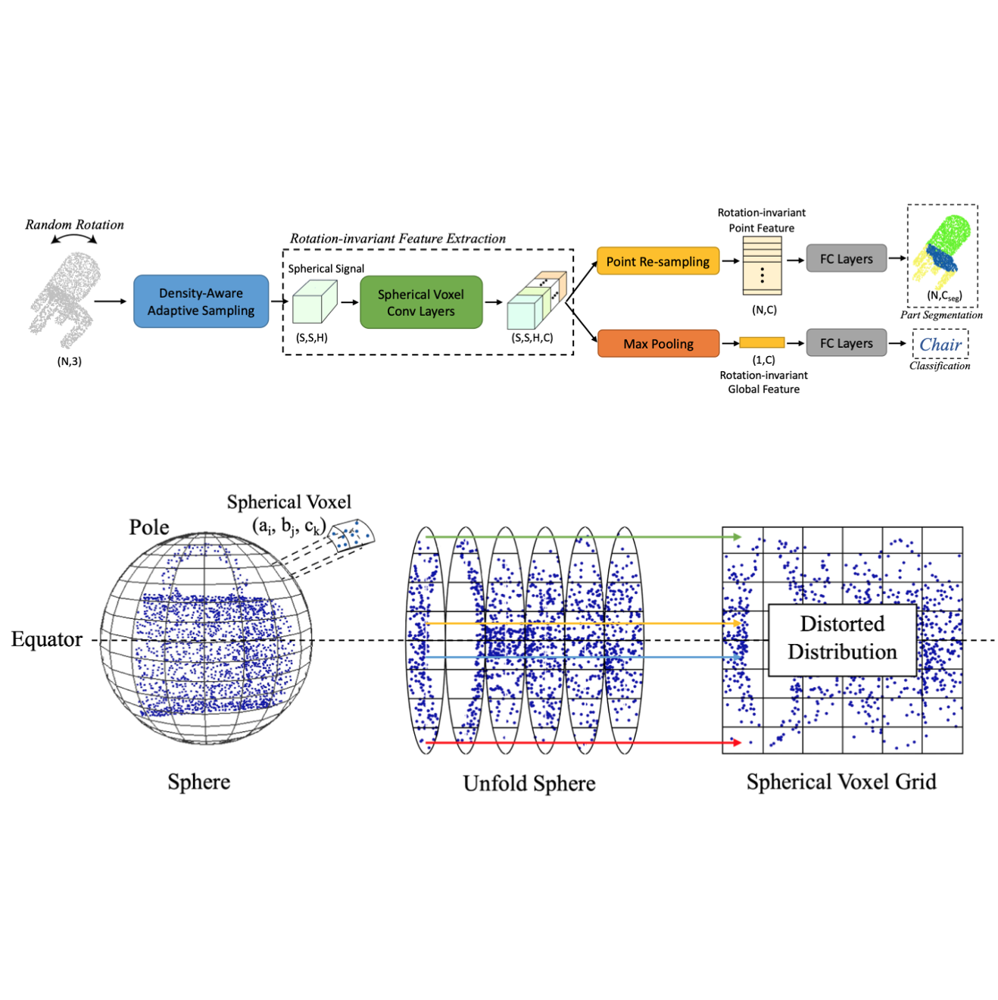
        

      </td>
      <td>
        <papertitle>
          <strong> Pointwise Rotation-invariant Network with Adaptive Sampling and 3D Spherical Voxel Convolution </strong>
        </papertitle>
         
          Yang You*, <strong>Yujing Lou</strong>*, Qi Liu, Yu-Wing Tai, Lizhuang Ma, Cewu Lu, Weiming Wang (* equal contribution)
         
          <strong>AAAI Conference on Artificial Intelligence (AAAI), 2020</strong>
         
          [<a href="https://arxiv.org/abs/1811.09361">arXiv</a>] 
          [<a href="https://ojs.aaai.org/index.php/AAAI/article/view/6965">paper</a>] 
        </td>
    </tr>
</tbody>
</table>

## Public Services
### Reviewer:
* Conference: NeurIPS, ICML, ICLR, ICCV, CVPR, ECCV, AAAI, EMNLP, MM
* Journal: TPAMI, Neurocomputing
