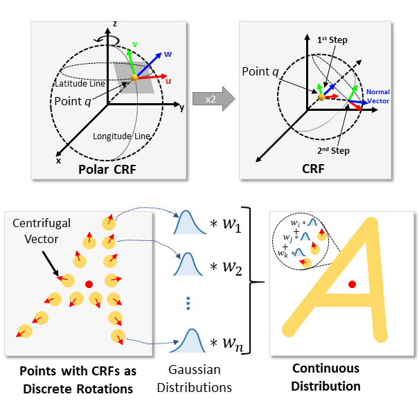
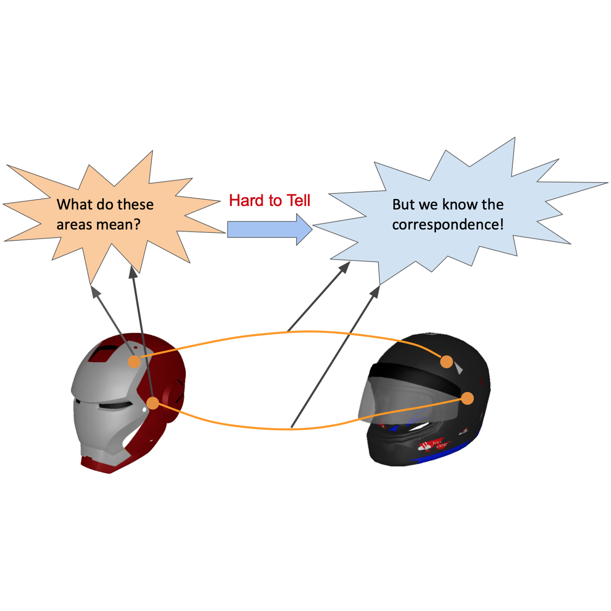

---
I am a Ph.D. candidate in the [Department of Computer Science and Engineering](http://www.cs.sjtu.edu.cn/) at [Shanghai Jiao Tong University](http://en.sjtu.edu.cn), advised by Prof. [Cewu Lu](http://mvig.sjtu.edu.cn) and Prof. [Lizhuang Ma](http://dmcv.sjtu.edu.cn/). Before that, I received my B.S degree (Computer Science and Technology) from [HIT](http://en.hit.edu.cn) in 2018, and M.S. degree (Computer Science and Technology) from [SJTU](http://en.sjtu.edu.cn) in 2020. My research interests include ***Computer Vision***, ***Scene/Object Understanding*** and ***Robotics***.
<!-- I was a member of Elite Program in <a href="http://honors.hit.edu.cn">Honors School of HIT</a> -->

## Publications
<table style="width:100%;border:0px;border-spacing:0px;border-collapse:separate;margin-right:auto;margin-left:auto;">
  <tbody>
    <tr onmouseout="nightsight_stop()" onmouseover="nightsight_start()">
      <td style="border:0px;padding:20px;width:25%;vertical-align:middle">
        

          
        

      </td>
      <td style="border:0px;padding:20px;width:75%;vertical-align:middle">
        <papertitle> 
          <strong>CRIN: Rotation-Invariant Point Cloud Analysis and Rotation Estimation via Centrifugal Reference Frame</strong>
        </papertitle>
         
          <strong>Yujing Lou</strong>, Zelin Ye, Yang You, Nianjuan Jiang, Jiangbo Lu, Weiming Wang, Lizhuang Ma, Cewu Lu
         
         
          <strong>AAAI Conference on Artificial Intelligence (AAAI), 2023 (Oral)</strong>
         
      </td>
    </tr>
    <tr onmouseout="nightsight_stop()" onmouseover="nightsight_start()">
      <td style="border:0px;padding:20px;width:25%;vertical-align:middle">
        

          
        

      </td>
      <td style="border:0px;padding:20px;width:75%;vertical-align:middle">
        <papertitle> 
          <strong> Canonical Voting: Towards Robust Oriented Bounding Box Detection in 3D Scenes </strong> 
        </papertitle>
         
          Yang You, Zelin Ye, <strong>Yujing Lou</strong>, Chengkun Li, Yong-Lu Li, Lizhuang Ma, Weiming Wang, Cewu Lu
         
         
          <strong>IEEE Conference on Computer Vision and Pattern Recognition (CVPR), 2022</strong>
         
          [<a href="https://arxiv.org/abs/2011.12001">arXiv</a>] 
          [<a href="https://openaccess.thecvf.com/content/CVPR2022/papers/You_Canonical_Voting_Towards_Robust_Oriented_Bounding_Box_Detection_in_3D_CVPR_2022_paper.pdf">paper</a>] 
          [<a href="https://github.com/qq456cvb/CanonicalVoting">code</a>]
      </td>
    </tr>
    <tr onmouseout="nightsight_stop()" onmouseover="nightsight_start()">
      <td style="border:0px;padding:20px;width:25%;vertical-align:middle">
        

          
        

      </td>
      <td style="border:0px;padding:20px;width:75%;vertical-align:middle">
        <papertitle> 
          <strong> PRIN/SPRIN: On Extracting Point-wise Rotation Invariant Features </strong>
        </papertitle>
         
          Yang You, <strong>Yujing Lou</strong>, Ruoxi Shi, Qi Liu, Yu-Wing Tai, Lizhuang Ma, Weiming Wang, Cewu Lu
         
         
          <strong>IEEE Transactions on Pattern Analysis and Machine Intelligence (TPAMI), 2021</strong>
         
          [<a href="https://arxiv.org/abs/2102.12093">arXiv</a>]
          [<a href="https://ieeexplore.ieee.org/document/9627565">paper</a>]
          [<a href="https://github.com/qq456cvb/SPRIN">code</a>]
      </td>
    </tr>
    <tr onmouseout="nightsight_stop()" onmouseover="nightsight_start()">
      <td style="border:0px;padding:20px;width:25%;vertical-align:middle">
        

          
        

      </td>
      <td style="border:0px;padding:20px;width:75%;vertical-align:middle">
        <papertitle>
          <strong> Localization with Sampling-Argmax </strong>
        </papertitle>
         
          Jiefeng Li, Tong Chen, Ruiqi Shi, <strong>Yujing Lou</strong>, Yong-Lu Li and Cewu Lu
         
         
          <strong>Thirty-Fifth Conference on Neural Information Processing Systems (NeurIPS), 2021</strong>
         
          [<a href="https://arxiv.org/abs/2110.08825">arXiv</a>] 
          [<a href="https://proceedings.neurips.cc/paper/2021/file/e4a6222cdb5b34375400904f03d8e6a5-Paper.pdf">paper</a>] 
          [<a href="https://github.com/Jeff-sjtu/sampling-argmax">code</a>]
      </td>
    </tr>
    <tr onmouseout="nightsight_stop()" onmouseover="nightsight_start()">
      <td style="border:0px;padding:20px;width:25%;vertical-align:middle">
        

          
        

      </td>
      <td style="border:0px;padding:20px;width:75%;vertical-align:middle">
        <papertitle>
          <strong> Understanding Pixel-level 2D Image Semantics with 3D Keypoint Knowledge Engine </strong>
        </papertitle>
         
          Yang You, Chengkun Li, <strong>Yujing Lou</strong>, Zhoujun Cheng, Liangwei Li, Lizhuang Ma, Weiming Wang, Cewu Lu
         
         
          <strong>IEEE Transactions on Pattern Analysis and Machine Intelligence (TPAMI), 2021</strong>
         
          [<a href="https://arxiv.org/abs/2111.10817">arXiv</a>]
          [<a href="https://ieeexplore.ieee.org/document/9403947/">paper</a>]
      </td>
    </tr>
    <tr onmouseout="nightsight_stop()" onmouseover="nightsight_start()">
      <td style="border:0px;padding:20px;width:25%;vertical-align:middle">
        

          
        

      </td>
      <td style="border:0px;padding:20px;width:75%;vertical-align:middle">
        <papertitle>
          <strong> Human Correspondence Consensus for 3D Object Semantic Understanding </strong>
        </papertitle>
         
          <strong>Yujing Lou*</strong>, Yang You*, Chengkun Li*, Zhoujun Cheng, Liangwei Li, Lizhuang Ma, Weiming Wang, Cewu Lu (*=equal contribution)
         
         
          <strong>European Conference on Computer Vision (ECCV), 2020</strong>
         
          [<a href="https://arxiv.org/abs/1912.12577">arXiv</a>]
          [<a href="https://www.ecva.net/papers/eccv_2020/papers_ECCV/papers/123670494.pdf">paper</a>]
          [<a href="https://github.com/yokinglou/CorresPondenceNet">code</a>]
      </td>
    </tr>
    <tr onmouseout="nightsight_stop()" onmouseover="nightsight_start()">
      <td style="border:0px;padding:20px;width:25%;vertical-align:middle">
        

          
        

      </td>
      <td style="border:0px;padding:20px;width:75%;vertical-align:middle">
        <papertitle>
          <strong> KeypointNet: A Large-scale 3D Keypoint Dataset Aggregated from Numerous Human Annotations </strong>
        </papertitle>
         
          Yang You, <strong>Yujing Lou</strong>*, Chengkun Li*, Zhoujun Cheng, Liangwei Li, Lizhuang Ma, Cewu Lu, Weiming Wang
         
         
          <strong>IEEE Conference on Computer Vision and Pattern Recognition (CVPR), 2020</strong>
         
          [<a href="https://arxiv.org/abs/2002.12687">arXiv</a>]
          [<a href="https://openaccess.thecvf.com/content_CVPR_2020/html/You_KeypointNet_A_Large-Scale_3D_Keypoint_Dataset_Aggregated_From_Numerous_Human_CVPR_2020_paper.html">paper</a>] [<a href="https://github.com/qq456cvb/KeypointNet">data</a>]
        </td>
    </tr> 
    <tr onmouseout="nightsight_stop()" onmouseover="nightsight_start()">
      <td style="border:0px;padding:20px;width:25%;vertical-align:middle">
        

          
        

      </td>
      <td style="border:0px;padding:20px;width:75%;vertical-align:middle">
        <papertitle>
          <strong> Pointwise Rotation-invariant Network with Adaptive Sampling and 3D Spherical Voxel Convolution </strong>
        </papertitle>
         
          Yang You*, <strong>Yujing Lou</strong>*, Qi Liu, Yu-Wing Tai, Lizhuang Ma, Cewu Lu, Weiming Wang (*=equal contribution) 
          
          <strong>AAAI Conference on Artificial Intelligence (AAAI), 2020</strong>
         
          [<a href="https://arxiv.org/abs/1811.09361">arXiv</a>] 
          [<a href="https://aaai.org/ojs/index.php/AAAI/article/view/6965">paper</a>] 
          [<a href="https://github.com/qq456cvb/PRIN">code</a>]
        </td>
    </tr>
</tbody>
</table>

## Public Services
Reviewer:
ICCV23, CVPR23, ECCV22, NeurIPS21/22 (Datasets and Benchmarks Track).
