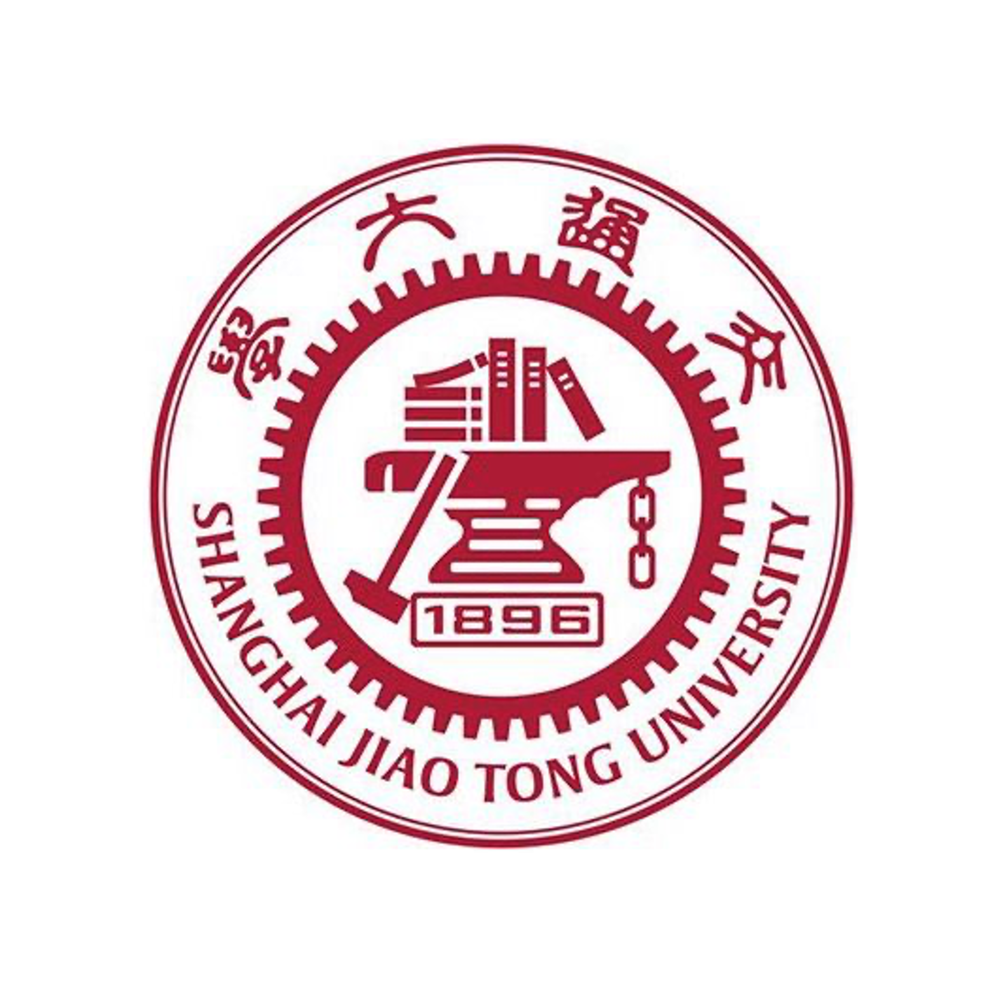
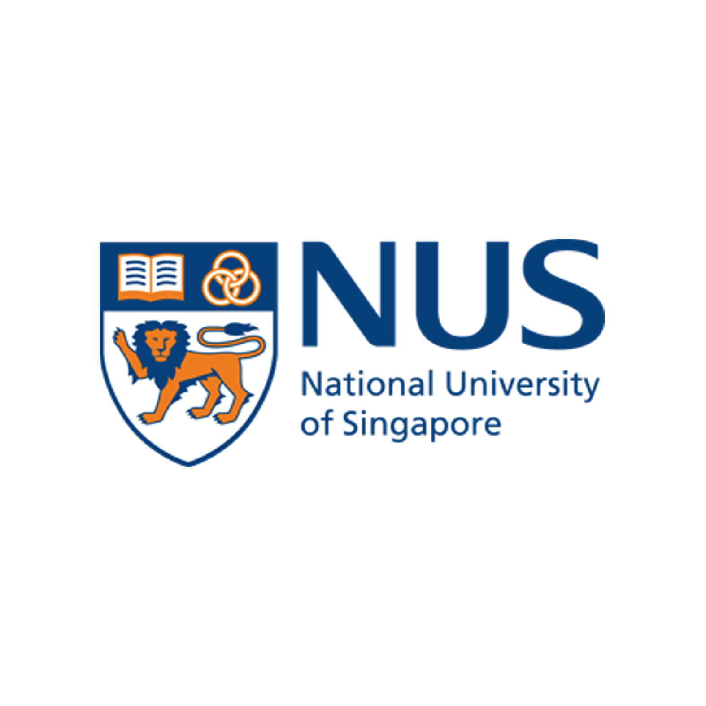

<!--  -->

Education
======
<table width="100%" align="center" border="0" cellpadding="20">
<tbody>
  <tr>
    <td style="border:0px;padding:20px;width:25%;vertical-align:middle">
      
    </td>
    <td style="border:0px" width="75%" valign="center">
      <strong>Shanghai Jiao Tong University</strong>
       
      Department of Computer Science and Engineering
        
      <strong>Sep. 2020 - Present</strong>
       
      Ph.D. Candidate
        
      <strong>Sep. 2018 - Sep. 2020</strong>
       
      Master of Computer Science and Technology
    </td>
  </tr>
  <tr>
    <td style="border:0px;padding:20px;width:25%;vertical-align:middle">
      
    </td>
    <td style="border:0px" width="75%" valign="center">
      <strong>National University of Singapore</strong>
       
      School of Computing
       
       
      <strong>Jul. 2017 - Aug. 2017</strong>
       
      Summer Research Program
    </td>
  </tr>
  <tr>
    <td style="border:0px;padding:20px;width:25%;vertical-align:middle">
      
    </td>
    <td style="border:0px" width="75%" valign="center">
      <strong>Harbin Institute of Technology</strong>
       
      School of Computer Science and Technology & Honors School
       
       
      <strong>Sep. 2014 - Jun. 2018</strong>
       
      Bachelor of Engineering
    </td>
  </tr>
</tbody>
</table>

Work experience
======
* Summer 2017: Research Intern
  * National University of Singapore
  * Supervisor: Prof. SOO Yuen Jien

* 2022.01-Present: Research Intern
  * SmartMore
  * Supervisor: Dr. Nianjuan Jiang

Honors and Awards
======
  * Top 10 Graduates of Honors School (10 in 230) • 2018
  * China National Scholarship, Ministry of Education of P.R. China • 2017
  * Samsung Scholarship • 2016 
  * Selected Member of HIT Elite Program in Computer Science (Honors School of HIT) • 2015 
  
<!-- Skills
======
* Skill 1
* Skill 2
  * Sub-skill 2.1
  * Sub-skill 2.2
  * Sub-skill 2.3
* Skill 3 -->

<!-- Publications
======
  <ul>
    
  </ul>
  
Talks
======
  <ul>
    
  </ul>
  
Teaching
======
  <ul>
    
  </ul>
  
Service and leadership
======
* Currently signed in to 43 different slack teams -->
